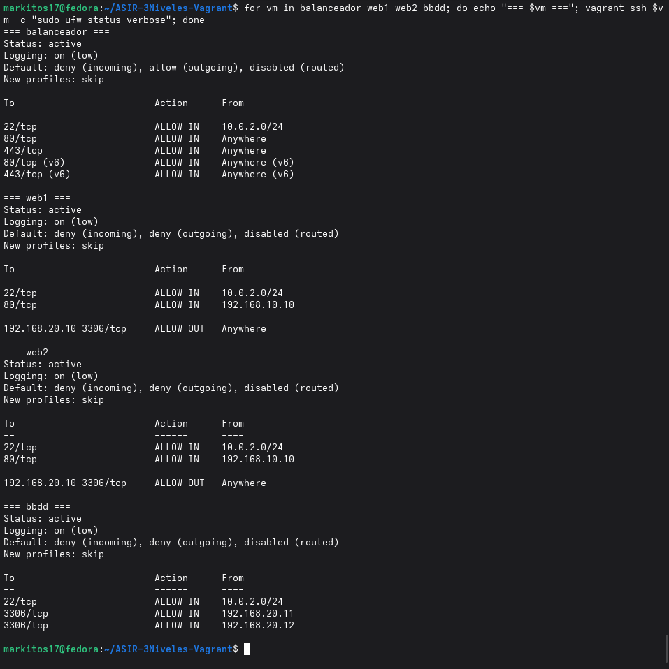
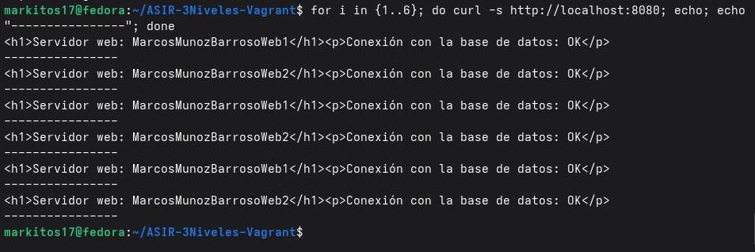
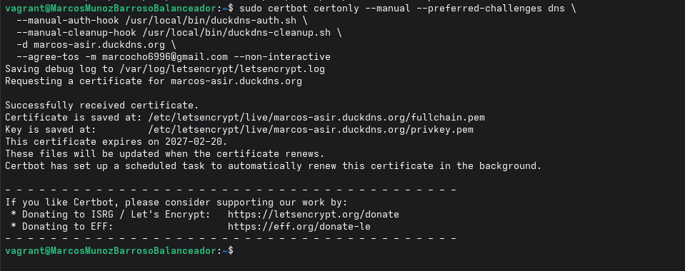
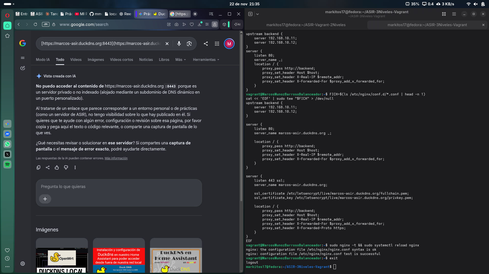
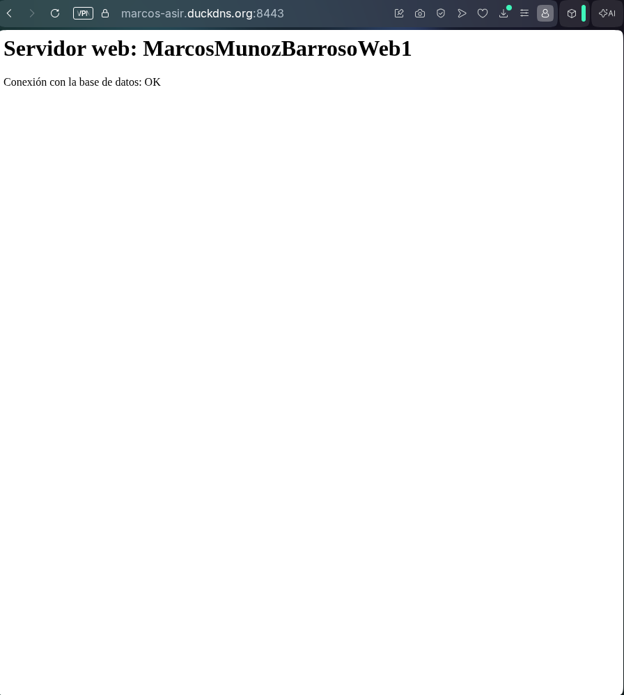

# Práctica ASIR: Infraestructura de 3 Niveles con Vagrant, UFW y HTTPS

## Índice
1. [Introducción y arquitectura](#1-introducción-y-arquitectura)
2. [Estructura del proyecto](#2-estructura-del-proyecto)
3. [Seguridad y cortafuegos (UFW)](#3-seguridad-y-cortafuegos-ufw)
4. [Certificado HTTPS con DuckDNS y Certbot](#4-certificado-https-con-duckdns-y-certbot)
5. [Configuración HTTPS en Nginx y pruebas finales](#5-configuración-https-en-nginx-y-pruebas-finales)
6. [Screencast de funcionamiento](#6-screencast-de-funcionamiento)

---

## 1. Introducción y arquitectura

En esta práctica he desplegado una infraestructura web dividida en tres capas utilizando **Vagrant** y **VirtualBox** sobre Fedora. El objetivo es separar la capa de entrada (balanceador expuesto), la capa de aplicación (servidores web en red privada) y la capa de datos (MariaDB en red privada aislada), asegurando las comunicaciones con cortafuegos y añadiendo cifrado HTTPS con un certificado válido.

El entorno está compuesto por 4 máquinas virtuales nombradas según el formato solicitado (`MarcosMunozBarrosoBalanceador`, `MarcosMunozBarrosoWeb1`, `MarcosMunozBarrosoWeb2` y `MarcosMunozBarrosoBBDD`) conectadas mediante dos redes internas aisladas (`red_frontal` y `red_datos`):

| Máquina | Función | IP Red Frontal | IP Red Datos | Puertos abiertos |
| :--- | :--- | :--- | :--- | :--- |
| **balanceador** | Proxy inverso y balanceo (Nginx) | `192.168.10.10` | - | `80` (8080 host), `443` (8443 host) |
| **web1** | Servidor web Apache + PHP | `192.168.10.11` | `192.168.20.11` | `80` (solo desde balanceador) |
| **web2** | Servidor web Apache + PHP | `192.168.10.12` | `192.168.20.12` | `80` (solo desde balanceador) |
| **bbdd** | Base de datos MariaDB | - | `192.168.20.10` | `3306` (solo desde web1 y web2) |

---

## 2. Estructura del proyecto

- `Vagrantfile`: Define las 4 máquinas, las redes privadas, los reenvíos de puertos y los aprovisionadores.
- `balanceador.sh`: Instala Nginx y configura el balanceo hacia `web1` y `web2`.
- `web.sh`: Instala Apache y PHP en los nodos web con la página de prueba de conexión a la base de datos.
- `bbdd.sh`: Instala MariaDB y crea la base de datos y el usuario remoto.
- `sin_internet.sh`: Restringe la salida a internet de las máquinas internas.
- `cortafuegos-balanceador.sh`, `cortafuegos-web.sh`, `cortafuegos-bbdd.sh`: Scripts que configuran las reglas de **UFW** en cada nivel.

---

## 3. Seguridad y cortafuegos (UFW)

Para proteger cada capa de la arquitectura (haciendo el equivalente a listas de control de acceso y grupos de seguridad) se ha configurado **UFW** con políticas restrictivas por defecto:

- **Balanceador:** Bloquea el tráfico entrante por defecto y permite SSH desde la red de gestión (`10.0.2.0/24`), además de HTTP (`80`) y HTTPS (`443`).
- **Servidores Web (`web1` y `web2`):** Bloquean tanto la entrada como la salida por defecto. Solo permiten SSH, tráfico HTTP entrante desde la IP del balanceador (`192.168.10.10`) y salida hacia el puerto `3306` de la base de datos (`192.168.20.10`).
- **Base de datos (`bbdd`):** Bloquea entrada y salida por defecto, permitiendo únicamente SSH y conexiones entrantes al puerto `3306` desde `192.168.20.11` y `192.168.20.12`.

Comprobación del estado y reglas de UFW en las 4 máquinas:

Prueba de balanceo tras activar los cortafuegos (alternando entre `Web1` y `Web2` con conexión `OK` a MariaDB):

---

## 4. Certificado HTTPS con DuckDNS y Certbot

Para habilitar HTTPS sin alertas de certificado autofirmado:

1. Se registró el subdominio gratuito `marcos-asir.duckdns.org` en **DuckDNS** apuntando a `127.0.0.1` (donde VirtualBox redirige el puerto `8443` hacia el `443` del balanceador).
2. Se instaló **Certbot** en el balanceador y se configuraron dos scripts (`duckdns-auth.sh` y `duckdns-cleanup.sh`) para validar la propiedad del dominio mediante registros DNS `TXT` usando la API de DuckDNS.

Obtención correcta del certificado de Let's Encrypt:

---

## 5. Configuración HTTPS en Nginx y pruebas finales

Una vez emitido el certificado, se añadió en Nginx el bloque `server` escuchando en el puerto `443 ssl` con las rutas de `fullchain.pem` y `privkey.pem`, manteniendo el balanceo hacia `web1` y `web2`.

Validación de la sintaxis y recarga del servicio Nginx:

Comprobación final desde el navegador accediendo a `https://marcos-asir.duckdns.org:8443`, donde se verifica el candado HTTPS válido y el reparto de carga entre ambos servidores web:

---

## 6. Screencast de funcionamiento

El vídeo demostrando el funcionamiento del balanceo HTTPS y la conexión a la base de datos se encuentra incluido en este repositorio en el archivo <video src="https://github.com/mmunnozb13-arch/ASIR-3Niveles-Vagrant/raw/main/demo.mp4" controls width="100%"></video>.
